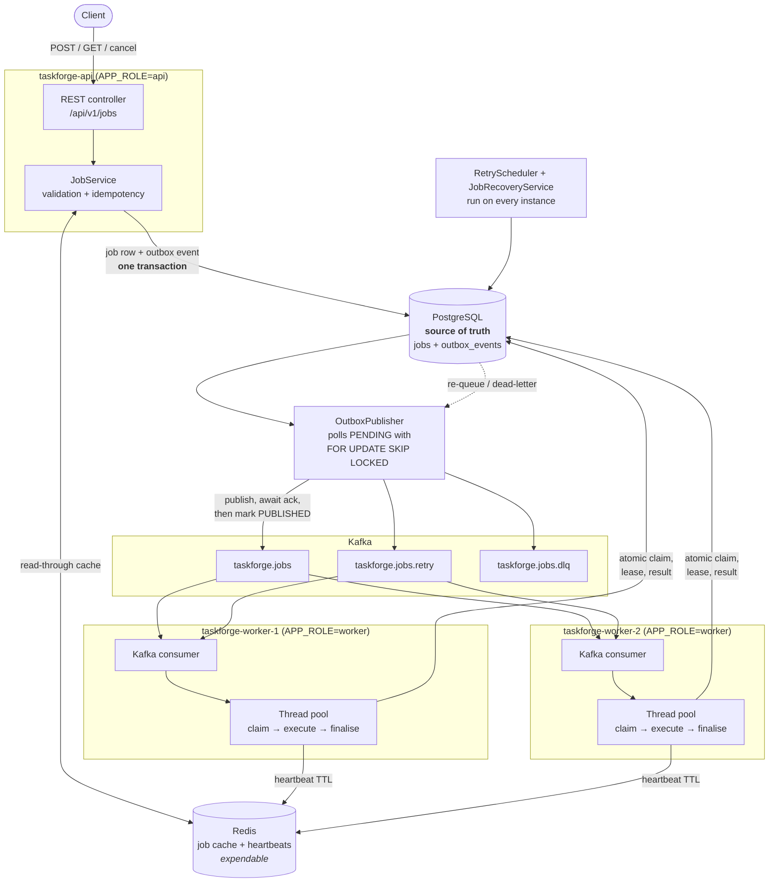
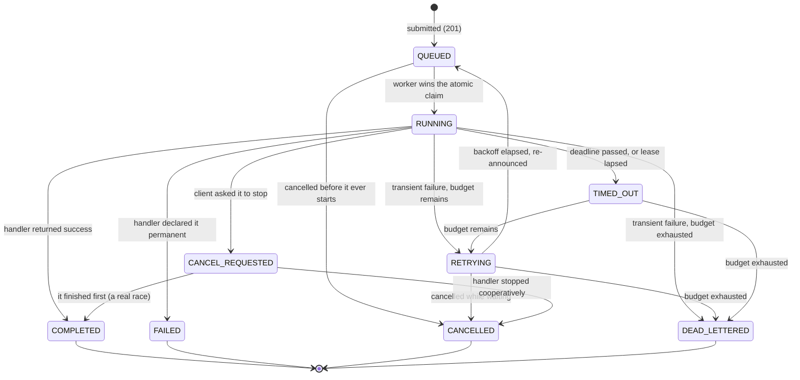

# TaskForge

[](https://github.com/AddysEdge/Task_forge/actions/workflows/ci.yml)

A distributed job execution platform built with **Java 21, Spring Boot, PostgreSQL, Kafka and Redis**.

Clients submit jobs over a versioned REST API. Each job is announced to Kafka through a transactional outbox, picked up by independent worker processes, and executed concurrently, with retries, cooperative cancellation, timeouts and dead-lettering. PostgreSQL is the single source of truth; Redis handles caching and worker heartbeats.

The whole design follows one assumption: **anything can be delivered twice, and any process can die at any moment.**

### Highlights

- **6 containers, one command:** `docker compose up --build` starts the API, 2 workers, PostgreSQL, Redis and Kafka.
- **No lost jobs on a crash:** the job row and its Kafka event commit together (transactional outbox); crashed workers' jobs are reclaimed through lease expiry and missing heartbeats.
- **Exactly one executor per claim:** an atomic `QUEUED -> RUNNING` compare-and-swap in SQL. In an 8-thread claim race, exactly 1 worker wins.
- **Fast cancellation:** cancelling a 120-second job takes about 1.8 seconds.
- **160 automated tests:** 113 unit tests plus 47 Testcontainers integration tests against real PostgreSQL, Kafka and Redis.
- **CI on every push:** GitHub Actions compiles, runs the unit and integration tests, packages the jar and builds the Docker image.

### Status

Builds and runs as documented. Development is paused; what was verified, what was not, and the known gaps are written down in [`HANDOFF.md`](HANDOFF.md) and in [Engineering trade-offs and limitations](#engineering-trade-offs-and-limitations).

---

## Table of contents

- [What it does](#what-it-does)
- [Architecture](#architecture)
- [Job lifecycle](#job-lifecycle)
- [Reliability model](#reliability-model)
- [Running locally](#running-locally)
- [API examples](#api-examples)
- [Job types](#job-types)
- [Testing](#testing)
- [Configuration](#configuration)
- [Project structure](#project-structure)
- [Engineering trade-offs and limitations](#engineering-trade-offs-and-limitations)

---

## What it does

| Capability | How it is implemented |
|---|---|
| Job submission over REST | Versioned API at `/api/v1/jobs` with Bean Validation and per-job-type payload checks |
| Idempotent submission | Unique index on `idempotency_key` in PostgreSQL — not an application-level check |
| Durable job state | PostgreSQL is the single source of truth; Flyway owns the schema |
| Asynchronous distribution | Kafka topics consumed by a shared consumer group |
| No lost jobs on crash | Transactional outbox: the job row and its Kafka event commit together |
| Multiple worker processes | Same image, `APP_ROLE=worker`, distinct `WORKER_ID`; Kafka splits partitions between them |
| Concurrency inside a worker | Bounded `ThreadPoolExecutor` with backpressure |
| Exactly-one execution | Atomic `QUEUED -> RUNNING` compare-and-swap in SQL |
| Duplicate-message tolerance | A worker executes only if it won that compare-and-swap |
| Retries | Exponential backoff persisted as `next_attempt_at`; no thread ever sleeps |
| Dead-lettering | Retry budget exhausted → `DEAD_LETTERED` + event on the DLQ topic |
| Cooperative cancellation | `CANCEL_REQUESTED` in the database, turned into a thread interrupt by the owning worker |
| Timeouts | In-worker watchdog against each job's own deadline |
| Crashed-worker recovery | Lease expiry + Redis heartbeat absence, reclaimed with `FOR UPDATE SKIP LOCKED` |
| Caching | Redis read-through cache, invalidated after commit on every state change |
| Health checks | Actuator with PostgreSQL, Redis and a custom Kafka indicator |
| Containerised environment | `docker compose up --build` starts API + 2 workers + PostgreSQL + Redis + Kafka |
| Automated testing | 113 unit tests + 47 Testcontainers integration tests |
| CI | GitHub Actions on every push and pull request: compile, unit tests, Testcontainers integration tests, package, Docker image build |

---

## Architecture



The important thing to notice: **Kafka never carries authority.** A `JobEvent` contains only a job id and some
metadata — no payload, no status a worker is expected to trust. It is a hint that a row is worth looking at. Every
worker re-reads PostgreSQL before doing anything.

---

## Job lifecycle



`COMPLETED`, `FAILED`, `CANCELLED` and `DEAD_LETTERED` are terminal and have **no** outgoing transitions. That is what
makes a duplicate Kafka message harmless: a terminal job matches no claim statement.

The rules live in exactly one place — [`JobStateMachine`](src/main/java/com/taskforge/service/JobStateMachine.java) —
and the same edges are enforced independently by the `WHERE` clauses in
[`JobRepository`](src/main/java/com/taskforge/repository/JobRepository.java).

---

## Reliability model

### Kafka is at-least-once, and TaskForge assumes it

A message can be delivered more than once: a consumer can process a record and die before its offset is committed, a
rebalance can replay a partition, and the outbox publisher itself can crash after Kafka accepted a record but before
the row was marked published. TaskForge does not try to prevent any of that. It makes it irrelevant.

### The atomic claim is the whole trick

Receiving a message grants nothing. Before executing, a worker runs:

```sql
UPDATE jobs
   SET status = 'RUNNING', worker_id = ?, started_at = ?, lease_expires_at = ?, version = version + 1
 WHERE id = ? AND status = 'QUEUED'
```

The `WHERE` clause is the compare, the `SET` is the swap, and PostgreSQL performs both atomically under a row lock.
Two workers handed the same message both run it; one gets `1` row and executes, the other gets `0` and stops. A job
that already completed matches nothing at all. There is no check-then-act window anywhere.

Verified live: 8 threads racing for one job produce exactly one winner
([`JobExecutionIT.onlyOneWorkerCanClaimAJob`](src/test/java/com/taskforge/it/JobExecutionIT.java)).

### Transactional outbox

Saving a job and then sending to Kafka would leave a window where a crash loses the job forever. Instead
[`JobCreator`](src/main/java/com/taskforge/service/JobCreator.java) writes the job row **and** an `outbox_events` row
in one transaction. A background publisher then drains the outbox: send → wait for the broker acknowledgement → mark
`PUBLISHED`.

If the process dies between the send and the mark, the event is sent again. That duplicate is deliberate — it is paid
for once, cheaply, by the atomic claim above. A Kafka outage leaves rows `PENDING` with a rising `attempt_count`, so
jobs are *delayed*, never *stranded*.

### Leases and crashed-worker recovery

A claim comes with `lease_expires_at`. The owning worker renews it every 15 s;
[`JobRecoveryService`](src/main/java/com/taskforge/recovery/JobRecoveryService.java) looks for `RUNNING` rows whose
lease lapsed or which have outrun their own timeout, and locks candidates with `FOR UPDATE SKIP LOCKED` so every
instance can run the scan concurrently without two of them recovering the same job.

Redis heartbeats *refine* that decision rather than driving it. If the owning worker is still heartbeating, an expired
lease is more likely a slow renewal than a death, so the job gets a grace period. If the heartbeat key is gone, it is
reclaimed at once. Redis being wrong can only change how fast recovery acts — never whether it is entitled to.

If a worker loses its lease mid-flight, its handler is stopped with `LEASE_LOST` and it writes **no** terminal state;
every one of its updates is guarded by `worker_id` and would be rejected anyway.

### Retries without blocking anything

A transient failure becomes `RETRYING` with a persisted `next_attempt_at = now + initialDelay * multiplier^(n-1)`.
[`RetryRequeueService`](src/main/java/com/taskforge/retry/RetryRequeueService.java) re-queues rows whose time has come
and re-announces them on the retry topic — through the outbox, in the same transaction as the status change.

No consumer thread ever sleeps for a backoff, and because the counter and the due time are both columns, retry
progress survives every process in the system restarting.

Retryable and permanent failures are distinct: only a `PermanentJobFailureException` (or an explicit
`PERMANENT_FAILURE` result) skips the retry budget. An *unexpected* exception is treated as transient, so an ordinary
bug does not burn the budget of a job that might have succeeded on a second attempt.

### Cache consistency

`GET /api/v1/jobs/{id}` reads Redis, falls back to PostgreSQL on a miss, and repopulates. Two rules keep the cache
from ever contradicting the database:

1. **Invalidate, never update** — a state change deletes the key, so a slow writer cannot resurrect an older state.
2. **Invalidate after commit** — deleting before commit would let a concurrent reader repopulate from the pre-commit
   row. [`JobCache`](src/main/java/com/taskforge/cache/JobCache.java) defers the delete to after-commit when a
   transaction is active.

Redis being unavailable degrades reads to PostgreSQL; it is logged, never silently swallowed. The TTL is the backstop
for a missed invalidation.

### Cooperative cancellation

TaskForge never forcibly kills a handler thread — there is no safe way to do that to arbitrary code. Cancellation is a
two-part signal: a flag on the `JobExecutionContext` and a thread interrupt. Handlers poll
`context.checkStopRequested()` inside their loops and let `InterruptedException` propagate.

The API cannot interrupt a thread in another container, so it writes `CANCEL_REQUESTED` to the row and the owning
worker's `CancellationPoller` turns that into a real interrupt. **This is best-effort:** a handler that ignores the
signal will run to completion, and the job will only leave `CANCEL_REQUESTED` when it does.

Verified live: a 120-second sleep cancelled in about 1.8 seconds.

---

## Running locally

Requirements: **Docker** and **Docker Compose**. Nothing else — the image builds the code.

```bash
git clone <repository-url>
cd taskforge
docker compose up --build
```

This starts six containers:

| Service | Port | Role |
|---|---|---|
| `taskforge-api` | 8080 | REST API (`APP_ROLE=api`) |
| `taskforge-worker-1` | 8081 | Worker process (`APP_ROLE=worker`, `WORKER_ID=worker-1`) |
| `taskforge-worker-2` | 8082 | Worker process (`APP_ROLE=worker`, `WORKER_ID=worker-2`) |
| `postgres` | 5432 | Durable job state |
| `redis` | 6379 | Cache + heartbeats |
| `kafka` | — | Single-node KRaft broker (no ZooKeeper) |

The application containers wait for PostgreSQL, Redis and Kafka health checks, and start regardless of transient
dependency unavailability (`initialization-fail-timeout: -1` on the connection pool, `missing-topics-fatal: false` on
the listener).

Check everything is up:

```bash
docker compose ps
curl -s http://localhost:8080/actuator/health
```

```json
{"status":"UP","components":{
  "db":{"status":"UP","details":{"database":"PostgreSQL"}},
  "kafka":{"status":"UP","details":{"clusterId":"taskforge-local-cluster","nodes":1}},
  "redis":{"status":"UP","details":{"version":"7.4.10"}}}}
```

Useful commands:

```bash
docker compose logs -f taskforge-worker-1     # watch one worker
docker compose down                           # stop
docker compose down -v                        # stop and wipe the volumes
```

### Running without Docker

Point the app at your own PostgreSQL, Redis and Kafka and run it in the combined `all` role:

```bash
./mvnw clean package
APP_ROLE=all \
DATABASE_URL=jdbc:postgresql://localhost:5432/taskforge \
KAFKA_BOOTSTRAP_SERVERS=localhost:9092 \
REDIS_HOST=localhost \
java -jar target/taskforge-1.0.0.jar
```

---

## API examples

### Submit a job

```bash
curl -i -X POST http://localhost:8080/api/v1/jobs \
  -H 'Content-Type: application/json' \
  -d '{
        "idempotencyKey": "client-request-123",
        "jobType": "DELAY",
        "payload": { "durationMs": 4000 },
        "maxRetries": 3,
        "timeoutSeconds": 60
      }'
```

`201 Created`, with a `Location` header:

```json
{"id":"f82adee5-d3f3-4b9f-bfa0-679f372de7b2","idempotencyKey":"client-request-123","jobType":"DELAY",
 "status":"QUEUED","payload":{"durationMs":4000},"createdAt":"2026-08-12T22:35:21.695972Z",
 "attempt":1,"retryCount":0,"maxRetries":3,"timeoutSeconds":60,"version":0}
```

`maxRetries` (0–10) and `timeoutSeconds` (1–3600) are optional and default to 3 and 60.

### Idempotency

Re-submitting the same `idempotencyKey` returns **200** and the original job, never a second job:

```bash
curl -s -o /dev/null -w '%{http_code}\n' -X POST http://localhost:8080/api/v1/jobs \
  -H 'Content-Type: application/json' \
  -d '{"idempotencyKey":"client-request-123","jobType":"DELAY","payload":{"durationMs":4000}}'
# 200
```

The status code tells the caller whether *this* request was the one that created the job. Sixteen simultaneous
requests with one key produce exactly one `201`, fifteen `200`s, and one row in the database.

### Retrieve a job

```bash
curl -s http://localhost:8080/api/v1/jobs/f82adee5-d3f3-4b9f-bfa0-679f372de7b2
```

```json
{"id":"f82adee5-d3f3-4b9f-bfa0-679f372de7b2","jobType":"DELAY","status":"COMPLETED",
 "createdAt":"2026-08-12T22:35:21.695972Z","startedAt":"2026-08-12T22:35:21.989Z",
 "completedAt":"2026-08-12T22:35:26.030996Z","attempt":1,"retryCount":0,"maxRetries":3,
 "timeoutSeconds":60,"workerId":"worker-1","result":{"sleptMs":4000},"version":2}
```

### List jobs

```bash
curl -s 'http://localhost:8080/api/v1/jobs?page=0&size=10'
curl -s 'http://localhost:8080/api/v1/jobs?status=DEAD_LETTERED&size=20'
```

Newest first, paginated, optionally filtered by status. Dead-lettered jobs are readable through the same endpoint.

### Cancel a job

```bash
curl -s -X POST http://localhost:8080/api/v1/jobs/{jobId}/cancel
```

- Not yet started → `CANCELLED` immediately, and it never executes.
- Running → `CANCEL_REQUESTED`, then `CANCELLED` once the worker's handler stops.
- Already `COMPLETED` / `DEAD_LETTERED` → `409 Conflict`.

### See which workers are alive

```bash
curl -s http://localhost:8080/api/v1/workers
```

```json
[{"workerId":"worker-1","startedAt":"2026-08-12T22:34:14Z","lastHeartbeat":"2026-08-12T22:37:58Z",
  "status":"UP","activeJobs":0,"threadCount":4},
 {"workerId":"worker-2","startedAt":"2026-08-12T22:34:16Z","lastHeartbeat":"2026-08-12T22:38:00Z",
  "status":"UP","activeJobs":0,"threadCount":4}]
```

### Demonstration: retry, then success

```bash
curl -s -X POST http://localhost:8080/api/v1/jobs \
  -H 'Content-Type: application/json' \
  -d '{"idempotencyKey":"retry-demo-1","jobType":"FAIL_TEST",
       "payload":{"failUntilAttempt":2},"maxRetries":3,"timeoutSeconds":60}'
```

Attempts 1 and 2 fail, attempt 3 succeeds. Polling shows `QUEUED → RETRYING → COMPLETED`, ending with:

```json
{"status":"COMPLETED","attempt":3,"retryCount":2,"maxRetries":3,
 "result":{"failedAttempts":2,"succeededOnAttempt":3},"workerId":"worker-1"}
```

### Demonstration: dead-lettering

```bash
curl -s -X POST http://localhost:8080/api/v1/jobs \
  -H 'Content-Type: application/json' \
  -d '{"idempotencyKey":"dlq-demo-1","jobType":"FAIL_TEST",
       "payload":{"failUntilAttempt":99},"maxRetries":2,"timeoutSeconds":60}'
```

Ends as:

```json
{"status":"DEAD_LETTERED","attempt":3,"retryCount":2,"maxRetries":2,
 "errorMessage":"FAIL_TEST attempt 3 of a configured 99 failing attempts (retry budget exhausted)"}
```

The outbox records the whole journey, every row published:

```
JOB_SUBMITTED        topic=taskforge.jobs        status=PUBLISHED
JOB_RETRY_SCHEDULED  topic=taskforge.jobs.retry  status=PUBLISHED
JOB_RETRY_SCHEDULED  topic=taskforge.jobs.retry  status=PUBLISHED
JOB_DEAD_LETTERED    topic=taskforge.jobs.dlq    status=PUBLISHED
```

### Demonstration: work really is spread across processes

```bash
for i in $(seq 1 10); do
  curl -s -X POST http://localhost:8080/api/v1/jobs -H 'Content-Type: application/json' \
    -d "{\"idempotencyKey\":\"spread-$i\",\"jobType\":\"COMPUTE\",
         \"payload\":{\"operation\":\"PRIME_COUNT\",\"n\":2000000}}" > /dev/null
done
curl -s 'http://localhost:8080/api/v1/jobs?size=10' | grep -o '"workerId":"[^"]*"' | sort | uniq -c
```

Observed on a real run: 3 jobs on `worker-1`, 7 on `worker-2` — two separate containers, two JVMs, partitions split by
the Kafka consumer group.

---

## Job types

| Type | Payload | Behaviour |
|---|---|---|
| `DELAY` | `{"durationMs": 5000}` (1–300000) | Sleeps in 100 ms slices, checking the stop flag between them |
| `COMPUTE` | `{"operation":"PRIME_COUNT","n":1000000}` | Sieve of Eratosthenes, n ≤ 5,000,000 |
| `COMPUTE` | `{"operation":"FIBONACCI","n":10000}` | Exact `BigInteger` Fibonacci, n ≤ 20,000 |
| `COMPUTE` | `{"operation":"CHECKSUM","input":"abc","iterations":100000}` | Iterated SHA-256, ≤ 2,000,000 rounds |
| `FAIL_TEST` | `{"failUntilAttempt":2,"mode":"RETRYABLE"}` | Fails the first N attempts, then succeeds. `mode: PERMANENT` skips retries entirely |

Every limit is enforced at submission time, so a payload that could never execute is rejected with `400` rather than
queued, dispatched, failed and retried.

Adding a job type means writing one `@Component` implementing
[`JobHandler`](src/main/java/com/taskforge/execution/JobHandler.java). The registry discovers it and the worker loop is
untouched — there is no switch statement in the execution path. A type with no handler, or two handlers claiming one
type, fails at **startup** rather than at runtime.

---

## Testing

```bash
./mvnw clean test      # 113 unit tests, no Docker required
./mvnw clean verify    # the above plus 47 integration tests, then packages the jar
```

Integration tests start real PostgreSQL, Redis and Kafka containers via Testcontainers — Docker must be running.
Nothing is mocked, because the behaviour under test *is* the interaction with those systems: `SKIP LOCKED`,
unique-constraint races, at-least-once delivery and TTL expiry have no meaningful in-memory equivalent.

**Unit tests** cover the state machine (every legal and illegal edge), backoff arithmetic, all three handlers
including cooperative cancellation, the handler registry, payload validation, idempotency resolution, the execution
service's claim-or-skip logic, and recovery decision-making.

**Integration tests** cover the required end-to-end scenarios:

| Scenario | Test |
|---|---|
| submit → `QUEUED` → `RUNNING` → `COMPLETED` | `JobExecutionIT.executesASubmittedJobEndToEnd` |
| Duplicate idempotency key | `JobApiIT.repeatedSubmissionIsDeduplicated` |
| 16 concurrent identical submissions → one job | `JobApiIT.concurrentSubmissionsCollapseToOneJob` |
| Jobs genuinely overlap in time | `JobExecutionIT.runsJobsConcurrently` |
| 8 workers race, exactly one claims | `JobExecutionIT.onlyOneWorkerCanClaimAJob` |
| Duplicate Kafka delivery of a completed job | `JobExecutionIT.duplicateDeliveryDoesNotReExecuteACompletedJob` |
| Retry then success, retry count persisted | `RetryAndDeadLetterIT.retriesUntilTheJobSucceeds` |
| Retry budget exhausted → DLQ event | `RetryAndDeadLetterIT.deadLettersAJobThatNeverSucceeds` |
| Permanent failure skips retries | `RetryAndDeadLetterIT.permanentFailuresSkipRetriesEntirely` |
| Cancel a queued job | `JobApiIT.cancelsAQueuedJob` |
| Cancel a running job cooperatively | `JobExecutionIT.cancelsARunningJobCooperatively` |
| Timeout enforcement | `TimeoutAndRecoveryIT.enforcesJobTimeouts` |
| Abandoned job, dead worker | `TimeoutAndRecoveryIT.recoversAJobAbandonedByADeadWorker` |
| Heartbeat TTL expiry marks a worker stale | `TimeoutAndRecoveryIT.heartbeatsExpireAndMarkWorkersStale` |
| Cache invalidation after a transition | `CacheConsistencyIT.stateChangesInvalidateTheCachedJob` |
| Kafka publication failure does not strand jobs | `OutboxPublisherIT.publicationFailureDelaysButNeverStrandsAJob` |

That last one uses a genuinely unpublishable topic name against the real producer and the real background publisher,
then repairs it — rather than mocking the failure.

**Note on very new Docker daemons.** Testcontainers' client negotiates an older Docker Engine API version than Docker
29+ accepts, so the build pins API `1.44` (see `docker.api.version` in `pom.xml`). That works on every daemon from
Docker 25.0 onwards. On an older daemon, override it:

```bash
./mvnw clean verify -Ddocker.api.version=1.41
```

### CI

[`.github/workflows/ci.yml`](.github/workflows/ci.yml) runs on every push and pull request: checkout, JDK 21 with a Maven
cache, compile, unit tests, Testcontainers integration tests against real PostgreSQL, Kafka and Redis, package, and a
separate job building the Docker image. Test reports are uploaded as artifacts. The first run (October 2026) passed all
steps.

---

## Configuration

Everything is environment-variable driven with sensible local defaults. No secrets are hard-coded; see
[`.env.example`](.env.example).

| Variable | Default | Meaning |
|---|---|---|
| `APP_ROLE` | `all` | `api`, `worker`, or `all` — selects the active Spring profile |
| `WORKER_ID` | generated | Must be unique per worker process; job ownership is keyed on it |
| `DATABASE_URL` / `DATABASE_USERNAME` / `DATABASE_PASSWORD` | localhost/taskforge | PostgreSQL |
| `REDIS_HOST` / `REDIS_PORT` | localhost:6379 | Redis |
| `KAFKA_BOOTSTRAP_SERVERS` | localhost:9092 | Kafka |
| `WORKER_THREAD_COUNT` | 4 | Handler pool size |
| `WORKER_QUEUE_CAPACITY` | 100 | Bounded backlog before backpressure |
| `SERVER_PORT` | 8080 | HTTP port |

Tunables in `application.yml` under `taskforge.*` include the lease duration and renewal interval, heartbeat interval
and TTL, retry backoff (initial delay, multiplier, max delay, default max retries), outbox poll interval and batch
size, recovery interval and live-worker grace, cache TTL, topic names and partition count, and the payload/retry/timeout
limits.

### Database schema

Flyway owns the schema; Hibernate runs with `ddl-auto: validate` and only checks that the entities match.

- [`V1__create_jobs.sql`](src/main/resources/db/migration/V1__create_jobs.sql) — the `jobs` table, with a **unique
  index on `idempotency_key`** (the real idempotency guarantee), check constraints on retry/timeout ranges, `jsonb`
  payload and result columns, and partial indexes tuned to the two hot background scans (`lease_expires_at` where
  `status='RUNNING'`, `next_attempt_at` where `status='RETRYING'`) plus `(status, created_at DESC)` for listing.
- [`V2__create_outbox.sql`](src/main/resources/db/migration/V2__create_outbox.sql) — `outbox_events` with a partial
  index on pending rows, so the publisher's scan stays proportional to the backlog rather than to total history.

### Kafka topics

| Topic | Produced by | Consumed by |
|---|---|---|
| `taskforge.jobs` | Outbox, on submission | Workers |
| `taskforge.jobs.retry` | Outbox, when backoff elapses | Workers |
| `taskforge.jobs.dlq` | Outbox, on dead-lettering | Nothing — terminal by design |

Six partitions, job id as the key (so a job's events stay ordered relative to each other), one consumer group
(`taskforge-workers`) shared by all workers. Messages are plain JSON strings: no class names cross the wire, so nothing
on the broker can choose which Java type this process instantiates.

---

## Project structure

```
src/main/java/com/taskforge/
├── TaskForgeApplication.java     entry point; APP_ROLE selects the profile
├── cache/                        Redis job cache, worker heartbeat store
├── config/                       properties, worker identity, Kafka topics + health, Jackson
├── controller/                   JobController, WorkerController
├── dto/                          request/response records — entities never leave the service layer
├── entity/                       JobEntity, OutboxEventEntity
├── exception/                    typed exceptions + @RestControllerAdvice
├── execution/                    JobHandler SPI, context, result, registry
│   └── handler/                  DELAY, COMPUTE, FAIL_TEST
├── kafka/                        JobEvent, publisher, consumer
├── model/                        JobStatus, JobType, WorkerHeartbeat
├── outbox/                       OutboxWriter, OutboxPublisher + scheduler
├── recovery/                     JobRecoveryService + scheduler
├── repository/                   JobRepository (all atomic transitions), OutboxEventRepository
├── retry/                        BackoffCalculator, RetryRequeueService + scheduler
├── service/                      JobService, JobCreator, JobLifecycleService, JobStateMachine, JobMapper
├── validation/                   payload validation and field readers
└── worker/                       executor pool, execution service, lease renewer,
                                  cancellation poller, timeout watchdog, heartbeat publisher
```

63 main source files, 18 test files.

---

## Engineering trade-offs and limitations

**Cancellation is cooperative, and cannot be otherwise.** A handler that never checks the stop flag and never blocks
will run to completion; the job stays in `CANCEL_REQUESTED` until it does. Forcibly killing a thread
(`Thread.stop()`) can corrupt shared state and is not an option. The bundled handlers all cooperate.

**Delivery is at-least-once, never exactly-once.** A job can legitimately *start* twice — for example if a worker is
partitioned away long enough for its lease to expire while it is still executing. What cannot happen is two workers
both being allowed to finish it: the loser's writes are rejected by the `worker_id` guard. Handlers that touch external
systems should still be written idempotently.

**Recovery detects abandonment, it does not prevent duplicate work.** A job reclaimed from a frozen worker may run its
side effects a second time. The lease duration is the tuning knob: shorter means faster recovery and more risk of
reclaiming a merely slow worker; longer means the opposite.

**Backoff has no jitter.** It is deterministic so retry timing is exactly assertable in tests. At a scale where many
jobs fail simultaneously, jitter belongs in `BackoffCalculator`.

**The retry and recovery scans poll.** Every instance polls every 1 s and 10 s respectively. `SKIP LOCKED` makes that
safe and cheap at this scale, but it is polling, not event-driven.

**List results are not cached.** Any job changing state would invalidate them, so only single-job reads use Redis.

**One Kafka broker, one replica.** Fine for a local environment; a real deployment needs replication and
`min.insync.replicas` for the durability the producer's `acks=all` is meant to give.

**No authentication or authorisation.** The API is unauthenticated and every caller can see and cancel every job.
Actuator exposes only `health` and `info`, and unknown paths return a clean `404` rather than leaking anything — but
this is not an internet-facing service as it stands.

**Not implemented** (and deliberately not claimed): metrics, distributed tracing, Kubernetes manifests, autoscaling,
job priorities, scheduled/cron jobs, job dependencies, per-tenant quotas, and an admin UI. Adding Micrometer metrics
and structured JSON logging would be the most valuable next step, followed by authentication.
